# Architecture & System Design Document
## Digital Risk Protection (DRP) Platform — Social & App Store Surveillance

This document details the end-to-end architecture, data flows, detection algorithms, and storage schemas for the DRP Platform.

---

### 1. High-Level Architecture Diagram

```mermaid
flowchart TD
    subgraph BrandProfile ["1. Brand Profile & Ground Truth"]
        BP["Brand Definition\n- Brand Name & Trademarks\n- Official Logo URL\n- Whitelisted Social Handles\n- Official App Bundle/Package IDs\n- Authorized Publishers\n- Authorized Corporate Domains"]
    end

    subgraph IngestionLayer ["2. Data Ingestion & Discovery Layer"]
        A_APP["Apple App Store Connector\n(iTunes Search API - Public/Free)"]
        G_APP["Google Play Store Connector\n(Google Play Public Scraper)"]
        R_SOC["Reddit Public Connector\n(Subreddit & Community Search)"]
        W_SOC["Social Web Dorker\n(X/Twitter & Instagram Discovery)"]
    end

    subgraph ExclusionLayer ["3. Official Asset Exclusion Engine"]
        EX_CHECK{"Matches Brand Profile?\n(Bundle ID, Handle, Domain, Publisher)"}
        EX_TAG["Tag as OFFICIAL_ASSET\n(Score = 0.0, Excluded from Threat Alerts)"]
    end

    subgraph DetectionEngine ["4. Multi-Signal Detection & Scoring Engine"]
        S_NAME["Look-alike Name Engine (Bonus Credit)\n- Cyrillic/Greek Homoglyphs\n- Damerau-Levenshtein Swaps\n- Spacing & Delimiters\n- Affixes (Support, Claim, Desk)\n- Benign Dictionary Suppression"]
        S_PFP["Visual Matcher (pHash)\n- Perceptual Image Hashing\n- 64-bit Hamming Distance\n- Logo Clone Severity"]
        S_DESC["Description & Intent Classifier\n- Scam Keyword Density\n- Phishing Language Patterns\n- Fake Support Claims"]
        S_REP["Reputation & Community Complaint Tracker\n- 1-Star Review Clusters\n- Fraud & Impersonator Mentions\n- Abuse Flags"]
        S_PUB["Publisher Integrity Verifier\n- Unregistered Developer Mismatch"]
        S_LINK["Domain & Redirect Verifier\n- Shorteners, Telegram & Suspicious TLDs"]
    end

    subgraph AggregationLayer ["5. Weighted Composite Aggregator"]
        WEIGHTS["Dynamic Weights:\nDesc (25%), Logo (20%), Name (20%),\nComplaints (15%), Publisher (10%), Link (10%)"]
        FINAL_SCORE["Composite Threat Score (0 - 100)\n& SOC Severity Classification\n(Critical, High, Medium, Low)"]
    end

    subgraph PresentationLayer ["6. SOC Analyst Intelligence Dashboard"]
        DASH["Modern Dark UI (Zajno Design Standard)\n- Multi-Dimensional Sorting (Score, PFP, Name, etc.)\n- Side-by-Side Visual Diff Inspector\n- Explainable AI Attribution Bars\n- 1-Click Takedown Package Generator"]
    end

    BP --> IngestionLayer
    IngestionLayer --> EX_CHECK
    EX_CHECK -- "YES (Matches Ground Truth)" --> EX_TAG --> DASH
    EX_CHECK -- "NO (Suspect Candidate)" --> DetectionEngine
    DetectionEngine --> WEIGHTS --> FINAL_SCORE --> DASH
```

---

### 2. Exclusion Logic (Preventing Over-flagging of Official Assets)

The brief explicitly stipulates that **official accounts and apps must not be flagged**. The platform enforces this through a zero-tolerance front-gate filter (`exclusion.py`):
1. **Bundle / Package ID Check:** Matches against `official_app_ids` (e.g. `com.binance.dev`, `id1436799971`).
2. **Handle Whitelist:** Normalizes and compares social handles (e.g. `@binance`, `r/binance`).
3. **Publisher Whitelist:** Matches the developer entity against `official_publishers` (e.g. `Binance Ltd.`).
4. **Domain Authorization:** Verifies official domain hosting against `official_domains`.

Any matching entity is marked as `is_official_asset: true`, assigned a composite risk score of `0.0`, and routed to a dedicated verified section.

---

### 3. Look-alike Name Detection (Bonus Feature Implementation)

To capture bonus marks without over-flagging legitimate names:
* **Homoglyph & Confusable Mapping:** Detects cross-alphabet character spoofing (e.g., Cyrillic `а` replacing Latin `a`).
* **Adjacent Character Swaps:** Uses Damerau-Levenshtein edit distance for transpositions (e.g. `biannce` $\leftrightarrow$ `binance`).
* **Spacing & Delimiter Manipulation:** Strips spaces and symbols (`b i n a n c e` $\to$ `binance`).
* **Affix & Keyword Injection:** Recognizes scam modifiers (`binance_support`, `official_binance_desk`).
* **Dictionary Suppression:** Dampens risk if a 1-character difference matches a standard English word (e.g. `finance` vs `binance`) to eliminate false positives.

---

### 4. Community Complaint & Reputation Metric

Because native social platforms do not expose private report counts via public APIs:
* The platform parses public scam signals, negative review clusters (1-star apps), and community comments containing fraud indicators (`"fake"`, `"stole funds"`, `"phishing"`, `"impersonator"`).
* This provides a verifiable, empirical **Complaint & Reputation Risk Score** ($S_{\text{reports}}$) integrated into the final formula.

---

### 5. Data Sources & Graceful Degradation Strategy

| Source | Target Surface | Protocol / Access | Fault Tolerance |
| :--- | :--- | :--- | :--- |
| **Apple App Store** | iOS / iPadOS Apps | Public iTunes REST API (`itunes.apple.com/search`) | 4s Timeout, Non-blocking async |
| **Google Play Store** | Android Apps | Public HTML Store Parser | Fallback to benchmark honeypots |
| **Reddit API** | Social Communities | Public JSON API (`reddit.com/subreddits/search.json`) | Rate-limit resilient |
| **Social Web Dorker** | Twitter / Instagram | Light Search Dorker (`site:twitter.com`, `site:instagram.com`) | Graceful degradation |
